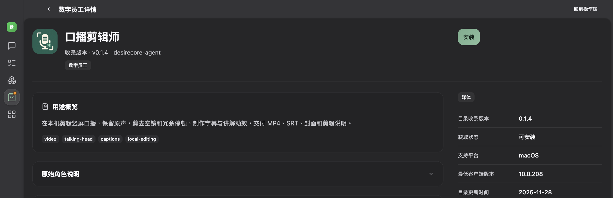
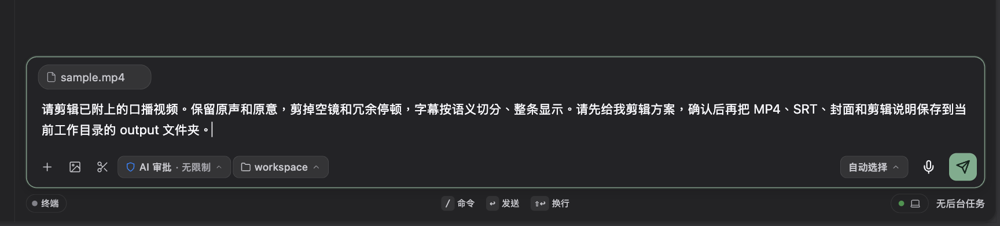
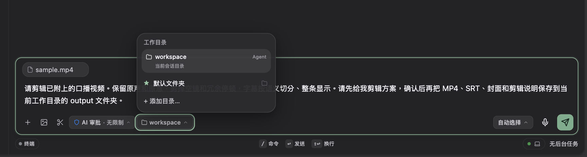
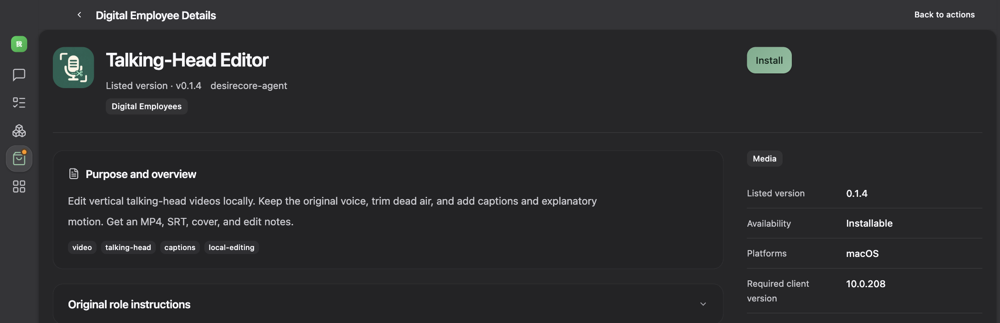
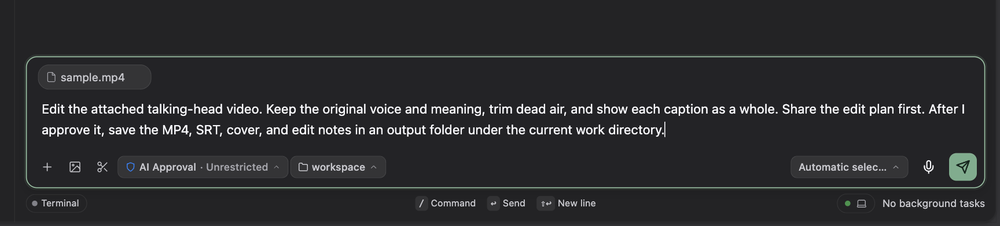
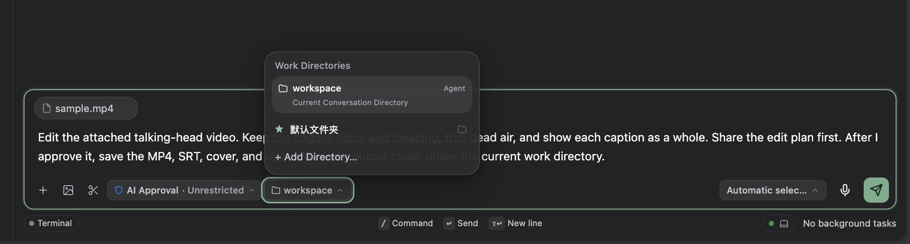

# 口播剪辑师 · Talking-Head Editor

[中文](#中文) · [English](#english)

## 中文

口播剪辑师在 DesireCore 里剪辑竖屏口播。它保留原声和原意，剪去空镜与冗余停顿，制作字幕和讲解动效，交付 MP4 预览、SRT 字幕、封面和剪辑说明。

### 1. 从市场安装

在 macOS 的 DesireCore 桌面端打开左侧「市场」，搜索 **口播剪辑师**，打开带绿色麦克风图标的条目，点击「安装」。安装后进入该智能体的对话。以后可从左侧「对话」重新打开口播剪辑师。

### 2. 把原片附到对话

把视频从 Finder 拖进对话，或点击输入框下方的 **＋（添加文件或文件夹）**，从系统选择器选中原片。文件名出现在输入框上方后，写下你希望保留、删掉或调整的内容，再点击「发送」。

同一段口播录了多遍时，可以把几段一起附上，说明它们是同一期，并告诉智能体如何选用。已有剪辑手册的，也可以附上手册文件。

可以这样发第一条消息。

> 请剪辑已附上的口播视频。保留原声和原意，剪掉空镜和冗余停顿，字幕按语义切分、整条显示。请先给我剪辑方案，确认后再把 MP4、SRT、封面和剪辑说明保存到当前工作目录的 output 文件夹。

### 3. 按需选择交付位置

初次使用可以直接用输入框下方显示的默认工作目录 `workspace`。想把交付放进自己的项目目录时，点击文件夹图标打开「工作目录」，选择已有目录，或点击「＋ 添加目录…」从 Finder 选择，然后回到列表选中它。底部目录名切换后，在消息里说清楚相对位置，例如「把交付放到当前工作目录的 `output/`」。

### 4. 确认方案，查看成片

1. 若要求先出方案，可在对话里标出要保留的起句、删掉的插句、字幕样式和动效位置。确认后回复「按这个方案剪辑」。
2. 若出现审批卡，先核对要执行的操作和涉及的文件。预检提示缺少离线转写工具、本地模型、字幕字体或可调用工具的算力时，按提示补齐后继续。
3. 交付后按回复中的文件位置查看成片。也可以打开「工作目录」菜单，点击对应目录右侧的文件夹图标在 Finder 中打开，再进入 `output/`。先播放 MP4 核对原话、字幕停留、剪切点和结尾。需要微调时，在原对话里说明时间点或对应台词。

## English

Talking-Head Editor cuts vertical talking-head footage inside DesireCore. It preserves the speaker’s voice and meaning, trims dead air and redundant pauses, adds captions and explanatory motion, and delivers an MP4 preview, SRT captions, a cover, and edit notes.

### 1. Install from the marketplace

In the DesireCore desktop app on macOS, open **Market** from the left sidebar and search for **Talking-Head Editor**. Open the listing with the green microphone icon and click **Install**. Open its chat after installation. You can return to it from the chat sidebar later.

### 2. Attach your footage in chat

Drag the video from Finder into the chat, or click **+ (Add file or folder)** below the composer and select it in the file picker. When the filename appears above the message field, describe what to keep, cut, or change, then click **Send**.

If you recorded several takes of the same segment, attach them together and explain how to choose between them. You can attach your editing playbook as well.

Here is a first message you can adapt.

> Edit the attached talking-head video. Keep the original voice and meaning, trim dead air, and show each caption as a whole. Share the edit plan first. After I approve it, save the MP4, SRT, cover, and edit notes in an output folder under the current work directory.

### 3. Choose a delivery location if needed

By default, use the agent’s `workspace`, shown below the composer. To save into your own project folder, click the folder icon to open **Work Directory**. Select an existing directory or click **+ Add Directory…**. Pick a folder in the system dialog, then select the added directory from the list. When the directory name changes in the toolbar, specify a location relative to it, such as `output/`.

### 4. Approve the edit plan and review the cut

1. If you asked for a plan first, use the same chat to refine the opening line, cuts, captions, and graphics. Reply with approval when you are ready for the agent to edit.
2. If DesireCore requests approval, review the proposed operation and the files involved. If preflight flags missing offline transcription, a local model, subtitle fonts, or tool-capable compute, follow that feedback before continuing.
3. Find the deliverables at the locations in the agent’s reply. You can also open **Work Directory**, click the folder icon beside the relevant directory to open it in Finder, and browse to `output/`. Play the MP4 to check the wording, caption timing, cuts, and ending. Request revisions in the same chat using timestamps or the matching spoken lines.
